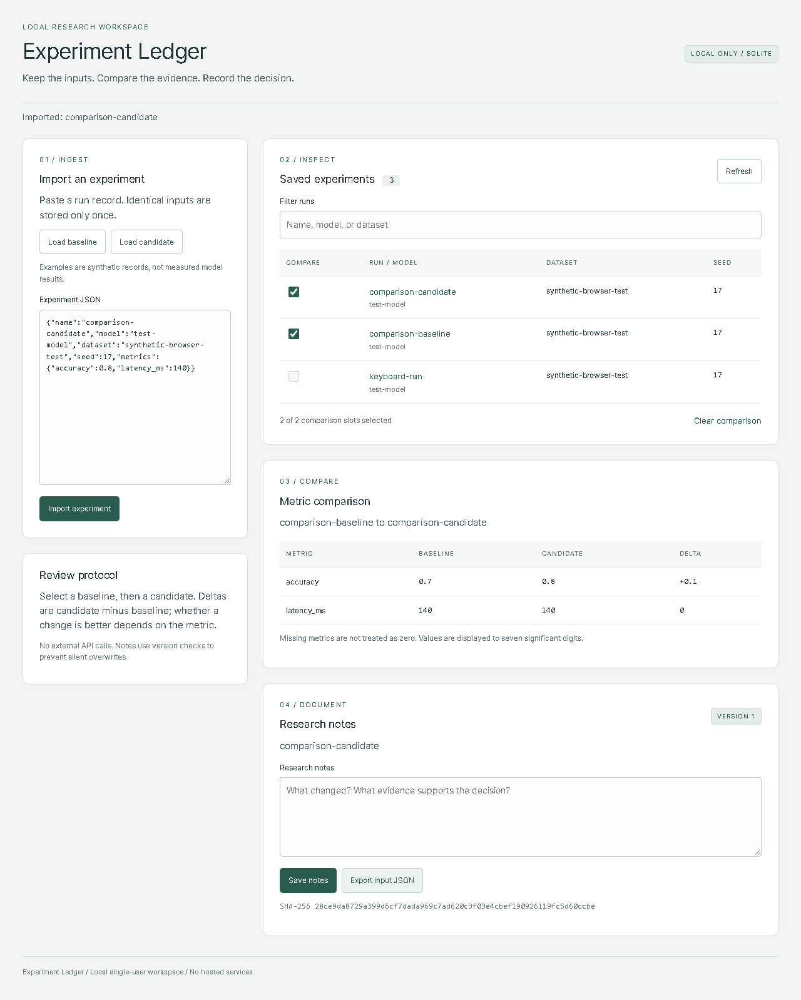

# Experiment Ledger (React / TypeScript / SQLite)

A complete local research workbench, not a frontend mockup. Import validated experiment records, compare two runs, filter saved results, edit versioned notes, and export an input record. A Node HTTP API persists data in SQLite; the React UI talks to that real API. Browser tests exercise the compiled app in a real local browser.



## Run

Node.js 22.15+ and npm. Dependencies are pinned in `package-lock.json`; Node's SQLite API is experimental in the tested Node 22 release.

```sh
npm ci --ignore-scripts --no-audit --no-fund
npm test
npm start
```

Open `http://127.0.0.1:8784`. `npm test` performs strict TypeScript checks, a Vite production build, and Node tests against real SQLite and HTTP servers. Runtime uses React, React DOM, and Node built-ins; no CDN, API key, remote database, subscription, or hosted processing. Dependency installation requires package-registry access; running the installed application does not.

`LEDGER_PORT` selects a port, and `LEDGER_DB` selects a database path (default `data/ledger.sqlite`). Existing data is retained. Build with `npm run build` after source changes. The screenshot and bundled input examples are synthetic demonstrations, not measured research outcomes.

## Real-browser verification

```sh
npm run test:browser
```

On Windows the default uses installed Microsoft Edge in headless mode. Set `LEDGER_BROWSER_CHANNEL=chrome` for installed Chrome. On other platforms the default is Playwright Chromium; install it once with `npx playwright install chromium`. All browsers/tests run on the local computer. The test server uses port 8797 and a new `.e2e/` SQLite file on every invocation; an existing server is never reused or terminated. It does not use the user's normal browser profile.

Tests cover keyboard import, duplicate imports, client validation, real persisted comparisons, JSON download, notes across page reload, two-session note conflicts, literal HTML rendering, server-side filtering, narrow-screen layout, and recovery from an injected API failure. Labels, semantic tables, focus styles, and a skip link are included; this is not a complete WCAG certification or a full assistive-technology audit.

## Data contract

```json
{
  "name": "run-01",
  "model": "ridge-v1",
  "dataset": "synthetic-holdout",
  "seed": 17,
  "metrics": { "accuracy": 0.72, "latency_ms": 140 }
}
```

Exactly these five fields are accepted. Names are trimmed and bounded; seeds are nonnegative 32-bit integers; one to thirty named finite numeric metrics are required. Canonical metric ordering gives identical input records the same SHA-256 digest. Duplicate imports return the existing record without resetting notes. A metric's meaning/unit/direction is supplied by the researcher; deltas are candidate minus baseline, and missing values are not zero.

Notes are separate from immutable input records. A save requires the current version. Stale writes return HTTP 409 and the UI retains the draft until the user explicitly reloads. Export writes the immutable five-field input JSON, not notes or a database backup. Search returns the newest 200 matches and reports truncation; SQL uses bound parameters and literal substring matching (SQLite lowercasing is primarily ASCII). This is a small local ledger, not a distributed artifact registry.

## API and trust boundary

- `GET /health`: readiness.
- `GET /api/runs?q=...`: filtered records plus `truncated`.
- `POST /api/runs`: import; 201 created / 200 identical input.
- `GET /api/runs/:id`: one stored record.
- `PATCH /api/runs/:id`: `{notes,version}`; 409 on stale version.

Writes require JSON and `X-Ledger-Client: 1`. Bodies are bounded at 64 KiB; notes at 4,000 characters. The service binds only to loopback, checks Host and Origin, rejects cross-site requests, and sends restrictive CSP/nosniff headers. There is **no user authentication or multi-tenant authorization**: local processes/users with access to the machine are trusted. Do not bind it to the public Internet or place it behind a forwarding proxy without redesigning this boundary. SQLite WAL and synchronous commits are used; disk failure, malware, backups, and power-loss recovery have not been certified.

## Design references

- React's build-from-scratch guidance: https://react.dev/learn/build-a-react-app-from-scratch
- Vite build tooling: https://vite.dev/guide/
- Playwright local web-server testing: https://playwright.dev/docs/test-webserver

See `VALIDATION.md` for exact local versions and test results. MIT licensed. No GitHub Actions or paid/cloud compute.
